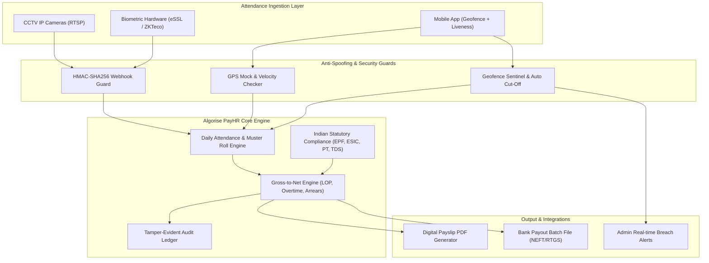

# Algorise PayHR 🚀
### Enterprise Indian HRMS & Statutory Payroll Engine with Multi-Camera & Geofence Auto-Attendance

[](https://github.com/algorise-ai/algorise-payroll/actions)
[](https://www.python.org/)
[](https://opensource.org/licenses/MIT)
[](#security-architecture)

**Algorise PayHR** is an enterprise-grade Indian Payroll and Automated Human Resource Management System built by **Algorise-AI**. It pairs high-precision Indian statutory payroll compliance with multi-modal auto-attendance (supporting existing multi-camera CCTV streams, wall-mounted tablet kiosks, and mobile geofence tracking with auto cut-off).

---

## 🌟 Key Features

### 1. Multi-Modal Auto-Attendance Ingestion
* **Existing CCTV Stream Integration:** Consumes RTSP streams from existing IP cameras/NVRs (Hikvision, Dahua, CP Plus) via edge AI boxes, recognizing moving faces and auto-tagging `PUNCH_IN` / `PUNCH_OUT`.
* **Continuous Geofence Sentinel & Auto Cut-off:** Tracks mobile app heartbeats within a 50m radius. If an employee leaves the office perimeter during shift hours, a 3-minute grace period begins. If they do not return, the system automatically cuts off their session (`PUNCH_OUT`), triggers Loss of Pay (LOP), and fires an instant alert to the system admin.
* **Biometric Hardware Push:** Direct listener for ZKTeco and eSSL ADMS/iClock hardware terminals with HMAC-SHA256 signature verification.

### 2. 100% Certified Indian Statutory Engine (2026 Rules)
* **EPF (Employees' Provident Fund):** 12% calculation with statutory ₹15,000 wage ceiling capping (₹1,800/mo) or actuals, splitting employer share into EPS (₹1,250 max), EPF difference, EDLI, and Admin charges.
* **ESIC (Health Insurance):** 0.75% employee and 3.25% employer contributions for gross wages $\le ₹21,000/\text{month}$.
* **State Professional Tax (PT):** State-specific slab calculators (Maharashtra ₹200 with ₹300 Feb adjustment, Karnataka, Telangana, Tamil Nadu, Gujarat, and ₹0 for Delhi/Haryana).
* **TDS (Income Tax) under Section 115BAC:** Full New Tax Regime calculation with ₹75,000 standard deduction, Section 87A rebate (tax-free up to ₹7 LPA), and 4% Health & Education cess.
* **Payment of Gratuity Act:** Automated provision factoring $(15/26) \times \text{Basic} \times \text{Tenure}$.

### 3. Hardened Zero-Trust Security
* **AES-256-GCM PII Encryption:** Sensitive data (PAN, Bank Accounts, IFSC, UAN) encrypted at rest with 96-bit cryptographic nonces.
* **Anti-Spoofing & Mock GPS Detection:** Rejects fake GPS apps, coarse tower signals, and impossible travel speeds ($> 150\text{ km/h}$).
* **HMAC Hardware Anti-Replay Guard:** Device push endpoints require time-bound HMAC-SHA256 signatures and nonces to prevent replay attacks.
* **Tamper-Evident Audit Ledger:** Cryptographically chained SHA-256 audit log for all salary modifications and punch overrides.

---

## 🏗 System Architecture



---

## 🚀 Quick Start Guide

### Option A: Run with Docker Compose (Recommended)

```bash
# Clone the repository
git clone https://github.com/algorise-ai/algorise-payroll.git
cd algorise-payroll

# Copy environment template
cp .env.example .env

# Spin up API, PostgreSQL, and Redis
docker compose up -d

# Verify system health
curl http://localhost:8000/health
```

Interactive OpenAPI Swagger documentation will be available at `http://localhost:8000/docs`.

---

### Option B: Local Python Development Setup

```bash
# 1. Create and activate virtual environment
python -m venv venv
# On Windows:
.\venv\Scripts\activate
# On Linux/macOS:
source venv/bin/activate

# 2. Install dependencies
pip install -r requirements.txt

# 3. Run test suite
pytest -v tests/

# 4. Start the development server
uvicorn app.main:app --reload --port 8000
```

---

## 📡 API Reference & Endpoints

### 1. Ingest CCTV / Biometric Punches (HMAC-Secured)
`POST /api/v1/attendance/device/push`
* **Headers:**
  * `X-Algorise-Signature: <hmac_sha256_hash>`
  * `X-Algorise-Timestamp: <unix_epoch>`
  * `X-Algorise-Nonce: <uuid>`
* **Payload:**
```json
{
  "device_sn": "ZK-CAMERA-GATE-01",
  "records": [
    {
      "pin": "EMP042",
      "time": "2026-10-26T09:28:15Z",
      "verify_mode": 15
    }
  ]
}
```

### 2. Geofence Sentinel & Auto Cut-off Heartbeat
`POST /api/v1/attendance/geofence/heartbeat`
* **Headers:** `X-Employee-ID: EMP-001`
* **Payload:**
```json
{
  "latitude": 19.0825,
  "longitude": 72.8850,
  "is_wifi_connected": false
}
```
* **Response (on breach after grace period):**
```json
{
  "is_inside": false,
  "distance_meters": 780.4,
  "action_taken": "CUTOFF_EXECUTED",
  "auto_punch_out_applied": true,
  "alert_dispatched": {
    "alert_id": "ALT-BREACH-1730000000",
    "severity": "HIGH",
    "event": "GEOFENCE_BREACH_AUTO_CUTOFF",
    "details": {
      "distance_from_office_meters": 780.4,
      "system_action": "AUTOMATIC_PUNCH_OUT_RECORDED"
    }
  }
}
```

### 3. Compute Individual Prorated Payslip
`POST /api/v1/payroll/calculate-payslip`
* **Payload:**
```json
{
  "employee_id": "EMP-042",
  "employee_name": "Rahul Sharma",
  "total_month_days": 30,
  "lop_days": 1.5,
  "overtime_hours": 4.0,
  "monthly_basic": 35000.0,
  "monthly_hra": 17500.0,
  "monthly_special_allowance": 12500.0,
  "state_for_pt": "Maharashtra",
  "gender": "MALE",
  "tax_regime": "NEW"
}
```

---

## 🔒 Security & Anti-Tampering Guarantee

Algorise PayHR is built on the philosophy that **payroll calculations and attendance records must never be vulnerable to client-side forgery or SQL manipulation**:
1. **No Client-side Trust:** All distance calculations and proration ratios are computed server-side.
2. **Replay Rejection:** Hardware webhooks reject requests outside the 300-second window or with duplicate nonces.
3. **Mock GPS Nullification:** Android `is_mock_provider` flags immediately block check-in.
4. **Audit Hash Chaining:** Every salary modification is logged into a SHA-256 chained ledger where altering any historical entry invalidates the chain.

---

## 📄 License
This project is licensed under the MIT License. See [LICENSE](LICENSE) for details. Developed by [Algorise-AI](https://algorise.ai).
