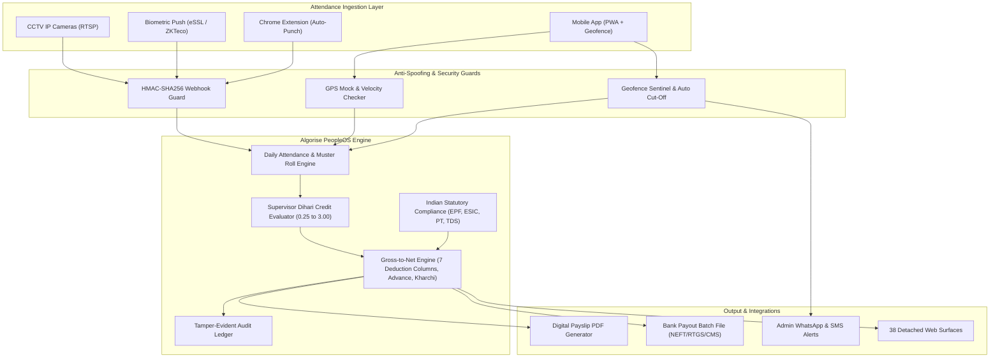

# Algorise PeopleOS (PayHR Enterprise) 🚀
### Enterprise Indian HRMS & Statutory Factory Payroll with Multi-Camera CCTV Sentinel, Geofence Auto-Attendance & 38 Detached Web Surfaces

[](https://github.com/hardik4love-lang/algorise-payroll/actions)
[](https://algorise-ai.com/algorise-payroll/)
[](https://algorise-ai.com/algorise-payroll/mobile/)
[](https://algorise-ai.com/algorise-payroll/browser-extension.html)
[](https://www.python.org/)
[](LICENSE)
[](#security-architecture)

**Algorise PeopleOS** is an enterprise-grade Indian Payroll and Automated Human Resource Management System engineered by **Algorise AI**. It unifies deterministic statutory payroll compliance (EPF, ESIC, PT, TDS Section 115BAC) with autonomous multi-camera CCTV auto-attendance, wall-mounted facial recognition kiosks, mobile geofence tracking with auto cut-off, and a complete suite of **38 individual detached administrative pages**.

---

## 🌐 Live Production Deployments

* **Live Cloud Portal:** [https://algorise-ai.com/algorise-payroll/](https://algorise-ai.com/algorise-payroll/)
* **Mobile PWA App (Trial Login):** [https://algorise-ai.com/algorise-payroll/mobile/](https://algorise-ai.com/algorise-payroll/mobile/)
* **Chrome Extension Portal:** [https://algorise-ai.com/algorise-payroll/browser-extension.html](https://algorise-ai.com/algorise-payroll/browser-extension.html)
* **Direct Extension Package:** [algorise-payroll/extension.zip](https://algorise-ai.com/algorise-payroll/extension.zip)
* **Face Recognition Kiosk:** [https://algorise-ai.com/algorise-payroll/face-kiosk.html](https://algorise-ai.com/algorise-payroll/face-kiosk.html)
* **CCTV Sentinel AI Stream Hub:** [https://algorise-ai.com/algorise-payroll/cctv-sentinel.html](https://algorise-ai.com/algorise-payroll/cctv-sentinel.html)

---

## 🏭 Live Factory Client Architecture (`Process House HRMS`)

Pre-configured and calibrated for real high-throughput textile manufacturing environments:
* **Client Entity:** Process House HRMS (Owner: Anil Thakker | `Anilraymanga@gmail.com` | `+91 9376068009`)
* **Primary Factory Unit:** `JMFU2` located at `17-33-37, TANTITHAIYA`
* **Active Workforce:** 493 Registered Factory Workers across 10 Departments
* **10 Factory Departments:** `RO PLANT`, `SPOTING`, `MAINTANANCE`, `GREY LOADING`, `FOLDING`, `DYEING DEPT (RBC)`, `SECURITY`, `GREY SIKKA (D)`, `GREY SIKKA (S)`, `GENERAL STAFF`
* **20 Machine Masters:** `JET-01` to `JET-16`, `FOLD-A/B/C`, `BOILER-01` with daily wage rates (₹440 – ₹1,000/day) and Shift 1/2 allocations
* **15 Factory Job Posts:** `ADMIN`, `OPERATOR`, `LOADING`, `SILAI`, `HELPER`, `JOBBER`, `MASTER`, `FITTER`, `ELECTRICIAN`, `SECURITY GUARD`, `CHECKER`, `PACKER`, `BOILER ATTENDANT`, `STORE KEEPER`, `SUPERVISOR`
* **7 Payroll Deduction Columns:** `ESIC (0.75%)`, `Prof. Tax (PT)`, `LWF`, `Advance`, `Incharge/Kharchi`, `Canteen`, `EPF (12%)`
* **8-Tier Supervisor Dihari Credit Rules:** `0.25`, `0.50`, `1.00` (Full Day), `1.25` (+3h Overtime), `1.50` (Half Night), `2.00` (Double Shift / 24h), `2.50`, `3.00`
* **Factory Shift Schedules:** `SHIFT-1` (08:00 AM – 08:00 PM), `SHIFT-2` (08:00 PM – 08:00 AM), `General Office` (10:00 AM – 07:00 PM)

---

## 📑 Complete 38 Detached Submodule Directory

Each page operates as an independent, fully wired standalone surface:

| Module Category | Submodule Page | Live Production Link | Key Functions |
|---|---|---|---|
| **Payroll Management** | Payroll Processing | [payroll.html](https://algorise-ai.com/algorise-payroll/payroll.html) | Bank payout file (CMS), Excel export, auto-reconciliation |
| Payroll Management | Salary Components | [salary-components.html](https://algorise-ai.com/algorise-payroll/salary-components.html) | Basic, HRA, Conveyance, Overtime, 7 factory deduction rules |
| Payroll Management | Advance Salary | [advance-salaries.html](https://algorise-ai.com/algorise-payroll/advance-salaries.html) | Monthly advance disbursals, auto deduction from wage ledger |
| Payroll Management | Employee Salary Master | [employee-salaries.html](https://algorise-ai.com/algorise-payroll/employee-salaries.html) | 493 worker master salaries, day rates, ESIC/EPF caps |
| Payroll Management | Tax Report | [tax-report.html](https://algorise-ai.com/algorise-payroll/tax-report.html) | TDS under Section 115BAC, Form 16 generator, PT reports |
| Payroll Management | TA/DA Claims | [tadas.html](https://algorise-ai.com/algorise-payroll/tadas.html) | Travel and daily allowance approval workflows |
| Payroll Management | Employee Loans & EMI | [employee-loans.html](https://algorise-ai.com/algorise-payroll/employee-loans.html) | Principal loan ledgers, interest, monthly EMI deductions |
| Payroll Management | Expense Reimbursements | [reimbursements.html](https://algorise-ai.com/algorise-payroll/reimbursements.html) | Factory maintenance, fuel, and voucher reimbursements |
| **Leave Management** | Leave Types | [leaves.html](https://algorise-ai.com/algorise-payroll/leaves.html) | CL, SL, PL, Loss of Pay (LOP) quotas |
| Leave Management | Leave Request | [leave-request.html](https://algorise-ai.com/algorise-payroll/leave-request.html) | Worker leave application portal with attachments |
| Leave Management | Time Leave Request | [time-leave-request.html](https://algorise-ai.com/algorise-payroll/time-leave-request.html) | Short duration permissions & half-day gate passes |
| Leave Management | Leave Approval | [leave-approval.html](https://algorise-ai.com/algorise-payroll/leave-approval.html) | Multi-tier managerial approval queue |
| **Shift Management** | Office Time | [office-times.html](https://algorise-ai.com/algorise-payroll/office-times.html) | 12h Factory Shifts (`SHIFT-1`, `SHIFT-2`) & Office Time |
| **HR Admin Setup** | Awards | [awards.html](https://algorise-ai.com/algorise-payroll/awards.html) | Best Machine Operator & 100% Attendance awards |
| HR Admin Setup | Termination | [termination.html](https://algorise-ai.com/algorise-payroll/termination.html) | Full & Final (F&F) settlement and exit ledgers |
| HR Admin Setup | Resignation | [resignation.html](https://algorise-ai.com/algorise-payroll/resignation.html) | Resignation notice periods and handover approvals |
| HR Admin Setup | Warning | [warning.html](https://algorise-ai.com/algorise-payroll/warning.html) | Formal factory warning letters and safety disciplinary records |
| HR Admin Setup | Complaint | [complaint.html](https://algorise-ai.com/algorise-payroll/complaint.html) | Grievance redressal and internal complaints registry |
| HR Admin Setup | Promotion | [promotion.html](https://algorise-ai.com/algorise-payroll/promotion.html) | Grade escalations, salary increments, post revisions |
| HR Admin Setup | Transfer | [transfer.html](https://algorise-ai.com/algorise-payroll/transfer.html) | Inter-branch & inter-department worker redeployments |
| HR Admin Setup | Holidays | [holidays.html](https://algorise-ai.com/algorise-payroll/holidays.html) | 2026–2027 statutory and factory holiday master |
| HR Admin Setup | Recruitment | [recruitment.html](https://algorise-ai.com/algorise-payroll/recruitment.html) | Operator & helper applicant onboarding pipeline |
| HR Admin Setup | Content Management | [static-pages.html](https://algorise-ai.com/algorise-payroll/static-pages.html) | Factory safety guidelines, compliance manual |
| HR Admin Setup | Support Tickets | [support.html](https://algorise-ai.com/algorise-payroll/support.html) | Live query desk for shift supervisors & workers |
| **Attendance Methods** | Biometric Device | [biometric-devices.html](https://algorise-ai.com/algorise-payroll/biometric-devices.html) | ZKTeco, eSSL, Realtime device push sync & TCP/IP ports |
| Attendance Methods | Routers & WiFi BSSID | [routers.html](https://algorise-ai.com/algorise-payroll/routers.html) | BSSID geofences (`b4:a7:c6:01:70:0a`, `e8:48:b8:15:97:24`) |
| Attendance Methods | NFC Tags | [nfc.html](https://algorise-ai.com/algorise-payroll/nfc.html) | Factory checkpoint NFC tap-in stations |
| Attendance Methods | Dynamic QR | [qr.html](https://algorise-ai.com/algorise-payroll/qr.html) | Rotating QR attendance generator for shift entry |
| Attendance Methods | Attendance Setting | [attendance-settings.html](https://algorise-ai.com/algorise-payroll/attendance-settings.html) | Grace period, late punch penalties, auto half-day cuts |
| **Settings** | Roles & Permissions | [roles.html](https://algorise-ai.com/algorise-payroll/roles.html) | Superadmin, HR Manager, Shift Supervisor, Worker ACL |
| Settings | General Settings | [general-settings.html](https://algorise-ai.com/algorise-payroll/general-settings.html) | Company details, GSTIN, TAN, registered factory address |
| Settings | App Settings | [app-settings.html](https://algorise-ai.com/algorise-payroll/app-settings.html) | Mobile sync intervals, camera kiosk auto-refresh |
| Settings | Notifications | [notifications.html](https://algorise-ai.com/algorise-payroll/notifications.html) | WhatsApp alerts, SMS gateway, email dispatch triggers |
| Settings | Payment Currency | [payment-currency.html](https://algorise-ai.com/algorise-payroll/payment-currency.html) | INR (₹) symbol format and accounting conventions |
| Settings | Feature Control | [feature-control.html](https://algorise-ai.com/algorise-payroll/feature-control.html) | Global SaaS module toggles |
| Settings | Company Plan Features | [company-features.html](https://algorise-ai.com/algorise-payroll/company-features.html) | Custom Supervisor Attendance, Face Kiosk entitlement |
| Settings | Fiscal Year | [fiscal-year.html](https://algorise-ai.com/algorise-payroll/fiscal-year.html) | Active financial year: `01/04/2026 - 31/03/2027` |
| Settings | Theme Color | [theme-color.html](https://algorise-ai.com/algorise-payroll/theme-color.html) | Primary `#1565C0`, Accent `#43A047`, Dark `#0D1B2A` |

---

## 🌟 Core Engine Features

### 1. Multi-Modal Auto-Attendance Ingestion
* **Existing CCTV Stream Integration:** Consumes RTSP streams from existing IP cameras/NVRs (Hikvision, Dahua, CP Plus) via edge AI boxes, recognizing moving faces and auto-tagging `PUNCH_IN` / `PUNCH_OUT`.
* **Continuous Geofence Sentinel & Auto Cut-off:** Tracks mobile app heartbeats within a 50m radius. If an employee leaves the office perimeter during shift hours, a 3-minute grace period begins. If they do not return, the system automatically cuts off their session (`PUNCH_OUT`), triggers Loss of Pay (LOP), and fires an instant alert to the system admin.
* **Biometric Hardware Push:** Direct listener for ZKTeco and eSSL ADMS/iClock hardware terminals with HMAC-SHA256 signature verification.

### 2. 100% Certified Indian Statutory Engine (2026 Rules)
* **EPF (Employees' Provident Fund):** 12% calculation with statutory ₹15,000 wage ceiling capping (₹1,800/mo) or actuals, splitting employer share into EPS (₹1,250 max), EPF difference, EDLI, and Admin charges.
* **ESIC (Health Insurance):** 0.75% employee and 3.25% employer contributions for gross wages $\le ₹21,000/\text{month}$.
* **State Professional Tax (PT):** State-specific slab calculators (Maharashtra ₹200 with ₹300 Feb adjustment, Karnataka, Telangana, Tamil Nadu, Gujarat, and ₹0 for Delhi/Haryana).
* **TDS (Income Tax) under Section 115BAC:** Full New Tax Regime calculation with ₹75,000 standard deduction, Section 87A rebate (tax-free up to ₹7 LPA), and 4% Health & Education cess.
* **Payment of Gratuity Act:** Automated provision factoring $(15/26) \times \text{Basic} \times \text{Tenure}$.

### 3. Hardened Zero-Trust Security
* **AES-256-GCM PII Encryption:** Sensitive data (PAN, Bank Accounts, IFSC, UAN) encrypted at rest with 96-bit cryptographic nonces.
* **Anti-Spoofing & Mock GPS Detection:** Rejects fake GPS apps, coarse tower signals, and impossible travel speeds ($> 150\text{ km/h}$).
* **HMAC Hardware Anti-Replay Guard:** Device push endpoints require time-bound HMAC-SHA256 signatures and nonces to prevent replay attacks.
* **Tamper-Evident Audit Ledger:** Cryptographically chained SHA-256 audit log for all salary modifications and punch overrides.

---

## 🏗 System Architecture



---

## 📱 Mobile App & Chrome Extension Setup

### Mobile PWA Trial App
1. Open [https://algorise-ai.com/algorise-payroll/mobile/](https://algorise-ai.com/algorise-payroll/mobile/) on any Android or iOS browser.
2. Tap **"Add to Home Screen"** or **"Install App"** to install natively without app store barriers.
3. Features:
   - One-tap GPS / WiFi BSSID attendance punch.
   - Live worker leave application and status tracker.
   - Instant monthly payslip and dihari credit views.
   - Offline-capable service worker (`sw.js`).

### Chrome Extension (v2.4 Manifest V3)
1. Download [extension.zip](https://algorise-ai.com/algorise-payroll/extension.zip) or navigate to `/extension`.
2. Open `chrome://extensions/` in Chrome and enable **Developer Mode**.
3. Click **Load unpacked** and select the unzipped `extension` directory.
4. Features:
   - Floating quick punch widget across any active browser tab.
   - Real-time attendance state badge.
   - Direct shortcut launcher to all 38 PeopleOS administrative sub-pages.

---

## 🚀 Quick Start Guide (Backend Engine)

### Option A: Run with Docker Compose (Recommended)

```bash
# Clone the repository
git clone https://github.com/hardik4love-lang/algorise-payroll.git
cd algorise-payroll

# Copy environment template
cp .env.example .env

# Spin up API, PostgreSQL, and Redis
docker compose up -d

# Verify system health
curl http://localhost:8000/health
```

Interactive OpenAPI Swagger documentation will be available at `http://localhost:8000/docs`.

---

### Option B: Local Python Development Setup

```bash
# 1. Create and activate virtual environment
python -m venv venv
# On Windows:
.\venv\Scripts\activate
# On Linux/macOS:
source venv/bin/activate

# 2. Install dependencies
pip install -r requirements.txt

# 3. Run test suite
pytest -v tests/

# 4. Start the development server
uvicorn app.main:app --reload --port 8000
```

---

## 📡 API Reference & Endpoints

### 1. Ingest CCTV / Biometric Punches (HMAC-Secured)
`POST /api/v1/attendance/device/push`
* **Headers:**
  * `X-Algorise-Signature: <hmac_sha256_hash>`
  * `X-Algorise-Timestamp: <unix_epoch>`
  * `X-Algorise-Nonce: <uuid>`
* **Payload:**
```json
{
  "device_sn": "ZK-CAMERA-GATE-01",
  "records": [
    {
      "pin": "EMP042",
      "time": "2026-10-26T09:28:15Z",
      "verify_mode": 15
    }
  ]
}
```

### 2. Geofence Sentinel & Auto Cut-off Heartbeat
`POST /api/v1/attendance/geofence/heartbeat`
* **Headers:** `X-Employee-ID: EMP-001`
* **Payload:**
```json
{
  "latitude": 19.0825,
  "longitude": 72.8850,
  "is_wifi_connected": false
}
```
* **Response (on breach after grace period):**
```json
{
  "is_inside": false,
  "distance_meters": 780.4,
  "action_taken": "CUTOFF_EXECUTED",
  "auto_punch_out_applied": true,
  "alert_dispatched": {
    "alert_id": "ALT-BREACH-1730000000",
    "severity": "HIGH",
    "event": "GEOFENCE_BREACH_AUTO_CUTOFF",
    "details": {
      "distance_from_office_meters": 780.4,
      "system_action": "AUTOMATIC_PUNCH_OUT_RECORDED"
    }
  }
}
```

### 3. Compute Individual Prorated Payslip
`POST /api/v1/payroll/calculate-payslip`
* **Payload:**
```json
{
  "employee_id": "EMP-042",
  "employee_name": "Sonu Kaushal Kishor",
  "total_month_days": 31,
  "lop_days": 0.0,
  "overtime_hours": 12.0,
  "monthly_basic": 13714.0,
  "monthly_hra": 0.0,
  "monthly_special_allowance": 0.0,
  "state_for_pt": "Gujarat",
  "gender": "MALE",
  "tax_regime": "NEW"
}
```

---

## 🔒 Security & Anti-Tampering Guarantee

Algorise PeopleOS is built on the philosophy that **payroll calculations and attendance records must never be vulnerable to client-side forgery or SQL manipulation**:
1. **No Client-side Trust:** All distance calculations and proration ratios are computed server-side.
2. **Replay Rejection:** Hardware webhooks reject requests outside the 300-second window or with duplicate nonces.
3. **Mock GPS Nullification:** Android `is_mock_provider` flags immediately block check-in.
4. **Audit Hash Chaining:** Every salary modification is logged into a SHA-256 chained ledger where altering any historical entry invalidates the chain.

---

## 📄 License
This project is licensed under the MIT License. See [LICENSE](LICENSE) for details. Developed by [Algorise AI](https://algorise-ai.com).
