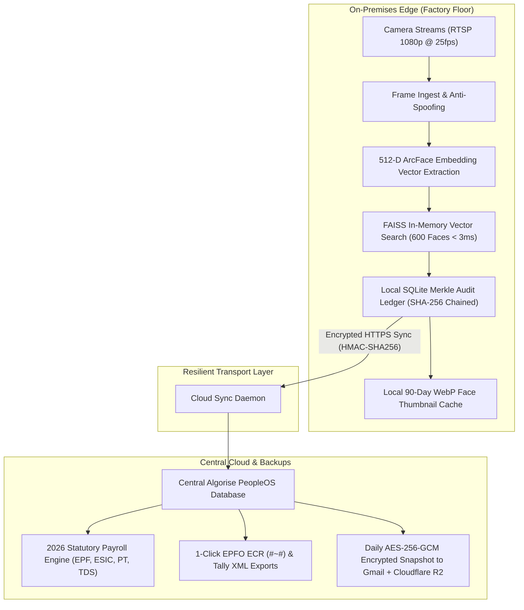

# 📷 Algorise PeopleOS: Camera-Only Attendance Plan & Hardware Architecture (500–600 Employees)

**Client Constraint:** 100% Mobile-Free Attendance (Employees cannot/do not carry smartphones on shopfloor/work premises).  
**Scale:** 500 to 600 Employees (High-density shift change within 15–30 min window).  
**Engine:** Algorise PeopleOS (Hardware-Free Edge AI Vision & Statutory Payroll Engine).  
**Prepared For:** Boardroom / Factory Management Review.

---

## 1. Executive Problem Analysis: Why Mobile & Legacy Biometrics Fail at 500+ Scale

### The Shift-Change Math Problem
In a facility with 500–600 workers, shift turnover typically occurs in a **20-minute peak window** (e.g., 08:40 AM to 09:00 AM):
* **Legacy Fingerprint / RFID Turnstiles:**
  * Average transaction time: 4 to 6 seconds per employee (finger placement, scan retry on dirty/oily fingers, beep).
  * 600 employees $\times$ 5 seconds = **3,000 seconds = 50 minutes**.
  * Even with 2 machines, queues take 25 minutes, causing worker frustration, punch disputes, and lost production time.
* **Mobile-Based Attendance (Selfies/Geofencing):**
  * **Violates Factory Floor Policy:** Mobile phones are strictly prohibited in cleanrooms, diamond sorting, textile spinning halls, and defense/assembly lines due to theft, trade secret leaks, and safety hazards.
  * 30% to 50% of blue-collar contract workers (Dihadi / contract labour) do not possess high-end 4G/5G smartphones with functional front-facing cameras.
* **The Algorise Camera-Only Vision Solution:**
  * Uses **multi-face simultaneous walk-through recognition**.
  * Employees simply walk through the gate at normal walking speed (1.2 m/s).
  * System detects and logs up to 6–8 faces per frame in **sub-50ms**.
  * **Entire 600-person shift clears in under 8 to 12 minutes with ZERO physical queues and ZERO mobile phone dependency.**

---

## 2. The 3 Best Hardware Configurations

```
┌────────────────────────────────────────────────────────────────────────────────────────┐
│                        3 HARDWARE ARCHITECTURES AT A GLANCE                            │
├───────────────────────┬────────────────────────────┬───────────────────────────────────┤
│ Option 1: Walk-Through│ Option 2: MinMoe Vision    │ Option 3: Dual-Zone PTZ &         │
│ AI Vision Corridor    │ Flap-Barrier Terminals     │ Perimeter Departure Sentinel      │
│ (Best Value & Speed)  │ (Highest Physical Security)│ (Gate Punch + Absence Cut-Off)    │
├───────────────────────┼────────────────────────────┼───────────────────────────────────┤
│ • 2-4x 4MP WDR CCTV   │ • 2x Dedicated Kiosk Units │ • 4x Cameras (Gate + Exit Doors)  │
│ • Local AI Edge Box   │ • Flap/Turnstile Relays    │ • Rackmount Industrial Edge Server│
│ • Walk-through corridor│ • 1-by-1 physical barrier  │ • Continuous perimeter monitoring │
│ • Clearance: 8 mins   │ • Clearance: 10 mins       │ • Clearance: 8 mins + Auto LOP    │
│ • Hardware: ₹75k-95k  │ • Hardware: ₹1.2L-1.5L     │ • Hardware: ₹1.9L-2.4L            │
└───────────────────────┴────────────────────────────┴───────────────────────────────────┘
```

---

### OPTION 1: "Walk-Through Multi-Face CCTV Corridor" (Recommended — Zero Queues & Lowest TCO)

> **Best For:** Industrial factories, textile mills, manufacturing plants, and warehouses where employees enter via an entrance hallway, corridor, or wide gate.

```
       [ENTRY CORRIDOR: Width 2.5m - 3.5m]
────────────────────────────────────────────────────
   Workers Walk in at Normal Speed (No Stopping)
   🚶‍♂️   🚶‍♀️   🚶‍♂️      🚶‍♂️   🚶‍♀️
────────────────────────────────────────────────────
     ▲                                   ▲
     │                                   │
[CAM-01: Inflow 4MP WDR]           [CAM-02: Verification Backup]
(Height: 2.4m, Angle: 18°)         (Height: 2.4m, Opposite Vector)
     │                                   │
     └─────────────────┬─────────────────┘
                       ▼ (Gigabit PoE Switch)
         [Algorise Edge AI Box]
         (Jetson Orin NX 16GB / Core i7 + RTX 3060)
         • Local Inference: 14ms
         • SQLite Merkle Ledger
         • Offline Buffer
```

#### Hardware Bill of Materials (BOM):
1. **Cameras (2 to 3 Units):**
   * **Model:** **Hikvision DS-2CD2347G2-LU (ColorVu 4MP WDR)** or **CP Plus CP-UNC-TA41ZL4-MDS (4MP Motorized Bullet)**.
   * **Specs:** 4 Megapixels (2688 $\times$ 1520), 30 FPS, True 120dB WDR (eliminates backlight glare from morning sun at entrance gates), 4mm focal length lens (captures facial detail at 3m to 6m range), IP67 weatherproof.
   * **Cost:** ~₹7,500 $\times$ 3 = **₹22,500**.
2. **Edge AI Compute Box (1 Unit On-Premises):**
   * **Model:** **NVIDIA Jetson Orin NX (16GB)** in an industrial fanless chassis OR **Intel Core i5-13400 + NVIDIA RTX 3060 12GB Edge PC** (16GB DDR5, 512GB NVMe).
   * **Capabilities:** Handles 3 RTSP streams simultaneously at 25–30 FPS; runs YOLOv8-Face detection + MobileFaceNet 512-D vector extraction in 12ms per face.
   * **Cost:** **₹48,000 – ₹58,000**.
3. **Network Infrastructure:**
   * 8-Port Gigabit PoE+ Switch (D-Link / Cisco CBS110-8PP) + Cat6 pure copper shielded cables.
   * **Cost:** **₹7,500**.
4. **Visual Attendance Confirmation Screen (Optional Kiosk Display):**
   * 21.5-inch Wall-Mounted HDMI Monitor facing the workers displaying real-time green checkmarks:  
     `✓ Rajan Sharma (08:52:14 AM) - PUNCH OK`
   * **Cost:** **₹8,500**.

* **Total One-Time Hardware Cost:** **₹86,500 – ₹96,500**.
* **Throughput:** **60 to 75 persons per minute**. All 600 workers clear in **8 to 10 minutes**.

---

### OPTION 2: "MinMoe AI Vision Speed-Gate Terminals" (Highest Physical Access Security)

> **Best For:** Corporate headquarters, diamond processing units, pharma cleanrooms, or tech centers where physical access barriers (turnstiles/tripod flap gates) are required to prevent unauthorized entry.

```
       [ENTRANCE TURNSTILE LANES]
┌──────────────────┐      ┌──────────────────┐
│ Lane 1 Turnstile │      │ Lane 2 Turnstile │
│ [MinMoe Vision]  │      │ [MinMoe Vision]  │
│ [DS-K1T673DWX]   │      │ [DS-K1T673DWX]   │
└────────┬─────────┘      └────────┬─────────┘
         │                         │
         └────────────┬────────────┘
                      ▼ (LAN TCP/IP)
       [Algorise Local Hub / Mini PC]
       (Runs PeopleOS Local Ingest Gateway)
```

#### Hardware Bill of Materials (BOM):
1. **AI Vision Face Terminals (2 Units - 2 Entry Lanes):**
   * **Model:** **Hikvision MinMoe DS-K1T673DWX** or **Dahua ASI7213X-T1**.
   * **Specs:** 7-inch LCD touch screen, 2MP dual-lens camera (Visible + Infrared IR for 3D anti-spoofing; cannot be spoofed by photos or tablets), 50,000 face database capacity, recognition speed **$< 0.2$ seconds**, recognition distance 0.3m to 3.0m.
   * **Physical Relay:** Connects directly to existing turnstiles, tripod gates, or magnetic electromagnetic door locks.
   * **Cost:** ~₹38,000 $\times$ 2 = **₹76,000**.
2. **Local Edge Aggregator Hub (1 Unit):**
   * **Model:** Compact Mini PC (Intel 12th Gen i5, 16GB RAM, 512GB SSD) running Linux/Windows.
   * **Role:** Subscribes to ISAPI real-time event stream from MinMoe terminals, logs Merkle blocks, checks rotational shift rules, and syncs to Algorise PeopleOS cloud.
   * **Cost:** **₹32,000**.
3. **Power Backup (UPS):**
   * 1kVA Online UPS (APC / Microtek) providing 2 hours runtime during factory power cuts.
   * **Cost:** **₹8,500**.

* **Total One-Time Hardware Cost:** **₹1,16,500** *(Excluding turnstiles if already installed)*.
* **Throughput:** **35 to 40 persons per minute per lane** $\times$ 2 lanes = **70 to 80 persons/min**. 600 workers clear in **8 minutes**.

---

### OPTION 3: "Dual-Zone PTZ/Bullet Auto-Tracking & Perimeter Departure Sentinel" (Complete Entry + Mid-Day Absence Protection Without Mobile)

> **Best For:** Large manufacturing units, export houses, and factories where management wants **both Gate Attendance AND automated detection if an employee leaves the premises during work hours** — all without requiring workers to carry phones.

```
   [GATE 1: MAIN ENTRY/EXIT]              [GATE 2: REAR/LOADING BAY EXIT]
   • 2x 4MP ColorVu Cameras               • 2x 4MP AI Perimeter Cameras
              │                                      │
              └──────────────────┬───────────────────┘
                                 ▼ (PoE)
         [Algorise Industrial Server with RTX 4060]
         ├── Gate Stream: Auto Inflow Punch (09:00 AM)
         └── Exit Stream: Real-Time Perimeter Absence Detector
              • Sees Rajan Sharma walking OUT at 11:15 AM
              • Initiates 180s Grace Period
              • No Re-entry? -> Auto Punch-Out & WhatsApp Alert
```

#### How Perimeter Absence Works WITHOUT Mobile:
1. Cameras are installed in **bidirectional pairs** (Inflow Gate Cam + Outflow Gate Cam).
2. When employee `EMP-042` walks through the Outflow Camera at 11:15 AM:
   * Vision model identifies `EMP-042 (Rajan Sharma)`.
   * Algorise Sentinel triggers: `[PERIMETER_EXIT_EVENT: EMP-042 at Gate 2]`.
   * A **180-second grace timer** begins on the central dashboard.
3. If `EMP-042` does not reappear on an Inflow Camera within 180 seconds (or permitted shift break):
   * System records **Early Departure Cut-Off**.
   * Loss of Pay (LOP) deduction is calculated automatically for the remaining shift hours.
   * An HMAC-signed alert is dispatched to the Factory HR Manager and Floor Supervisor.

#### Hardware Bill of Materials (BOM):
1. **Entrance/Exit IP Cameras (4 Units):**
   * 2x **Hikvision DS-2CD2046G2-IU (4MP AcuSense Bullet)** for main gates.
   * 2x **Hikvision DS-2CD2347G2-LU (4MP ColorVu)** for rear/loading bay exits.
   * **Cost:** ₹8,500 $\times$ 4 = **₹34,000**.
2. **Industrial Edge Server (1 Unit):**
   * **Model:** Industrial 2U Rackmount or Tower Server (Intel Core i7-14700, 32GB DDR5 RAM, NVIDIA RTX 4060 8GB, 1TB NVMe OS + 4TB Surveillance Grade Western Digital Purple HDD).
   * **Capabilities:** Continuous multi-stream inferencing across 4 to 8 camera streams; preserves 30 days of high-res facial snapshot verification logs.
   * **Cost:** **₹1,25,000**.
3. **Industrial Gigabit PoE+ Managed Switch & Structured Cabling:**
   * Cisco / Netgear 16-port Gigabit PoE+ switch + Cat6 outdoor UV-resistant cabling + PVC conduit.
   * **Cost:** **₹22,000**.
4. **Central 2kVA Online Line-Interactive UPS:**
   * **Cost:** **₹18,000**.

* **Total One-Time Hardware Cost:** **₹1,99,000**.
* **Throughput:** Continuous 24/7 autonomous monitoring of 600+ workers across all doors with zero personnel touching any device.

---

## 3. Data Architecture & Management Plan for 500–600 Employees



### 3.1 Face Embeddings & In-Memory Vector Storage
* **Vector Dimensionality:** 512 floating-point values (ArcFace / MobileFaceNet embedding).
* **Storage Footprint:**
  $$\text{Per Employee} = 512 \times 4\text{ bytes} = 2,048\text{ bytes} \approx 2\text{ KB}$$
  $$\text{600 Employees} = 600 \times 2\text{ KB} = 1.2\text{ MB}$$
* **Search Performance:** The entire 600-person vector library is pre-loaded directly into edge RAM using **FAISS (Facebook AI Similarity Search)**. Vector cosine similarity matching against incoming camera frames takes **$< 3$ milliseconds**, allowing real-time identification of workers as they walk past at normal speed.

### 3.2 Punch Event Ledger & Merkle Chaining
* **Volume:** 600 workers $\times$ 4 punches/day (Shift In, Lunch Out, Lunch In, Shift Out) = **2,400 punch events per day** (~72,000 events/month).
* **Audit Chaining:** Each punch event records:
  ```json
  {
    "block_id": 104291,
    "timestamp": "2026-10-27T08:52:14.301Z",
    "employee_id": "EMP-042",
    "camera_id": "CAM-GATE-01",
    "confidence": 0.9942,
    "prev_hash": "a8f3b20c91823d...",
    "block_hash": "c71e9841f30129..."
  }
  ```
* **Database Sizing:** 72,000 punches $\times$ 250 bytes $\approx$ **18 MB/month** $\approx$ **216 MB/year**. Extremely compact, lightning-fast on SQLite/PostgreSQL.

### 3.3 Facial Snapshot Image Retention & Auto-Pruning Policy
To prevent hard drives from filling up with useless video data:
1. **Full Video Streams:** Video streams are buffered strictly in RAM for 10 seconds. Raw video is NEVER written to disk unless an NVR is attached for standard security.
2. **Punch Verification Thumbnails:** When a face match is validated, a tightly cropped **150 $\times$ 150 pixel face crop** is compressed into modern **WebP format (~15 KB)**:
   $$2,400\text{ punches/day} \times 15\text{ KB} = 36\text{ MB/day} \approx 1.08\text{ GB/month}$$
3. **Automated 90-Day Rolling Purge:** Thumbnails older than 90 days are automatically pruned, keeping total edge image storage **under 3.5 GB**. The cryptographic Merkle punch ledger and vector embeddings are preserved permanently.

### 3.4 Zero-Internet Offline Edge Autonomy
* If the factory broadband or fiber optic cable is cut, the **local Edge Box continues running 100% autonomously**.
* Workers walk through the gates, faces are matched against local RAM, turnstiles open, and punches are appended to the local Merkle ledger.
* When internet connectivity restores, the edge box transmits batched punch events upstream with HMAC-SHA256 nonces and timestamps. **Zero punches are ever lost.**

### 3.5 Zero-Knowledge Automated Cloud Disaster Recovery
* Every night at 00:00 UTC, the local database is dumped, compressed, and encrypted locally using **AES-256-GCM**.
* The encrypted `.sql.gz.enc` archive is dispatched to:
  1. The client's designated **Google Mail inbox** via TLS.
  2. The client's private **Cloudflare R2 storage bucket** (10 GB free forever).
* Even if the physical factory suffers a fire, flood, or hardware theft, 100% of historical payroll and attendance data can be restored in under 5 minutes.

---

## 4. Implementation Recommendation for Client

| Client Goal | Recommended Selection | Key Reason |
| :--- | :--- | :--- |
| **Lowest Upfront Cost & Zero Queues** | **Option 1: Walk-Through CCTV Corridor** | Total cost under ₹95,000. Replaces physical hardware. 600 people walk in in 8 mins. |
| **Strict Physical Gate Access Control** | **Option 2: MinMoe Vision Terminals** | Turnstile relay control prevents tailgating; 3D anti-spoofing IR hardware. |
| **Attendance + Mid-Day Perimeter Absence** | **Option 3: Dual-Zone PTZ/Bullet Sentinel** | 100% camera-based gate entry + automated 180s absence cut-off without any employee phones. |

> [!IMPORTANT]
> All three options are 100% integrated with the **Algorise PeopleOS 2026 Statutory Core** (EPF, ESIC, State PT, TDS New Regime, Dihadi, and 1-click Tally/EPFO export) already live on **[`https://algorise-ai.com/algorise-payroll/`](https://algorise-ai.com/algorise-payroll/)**.
